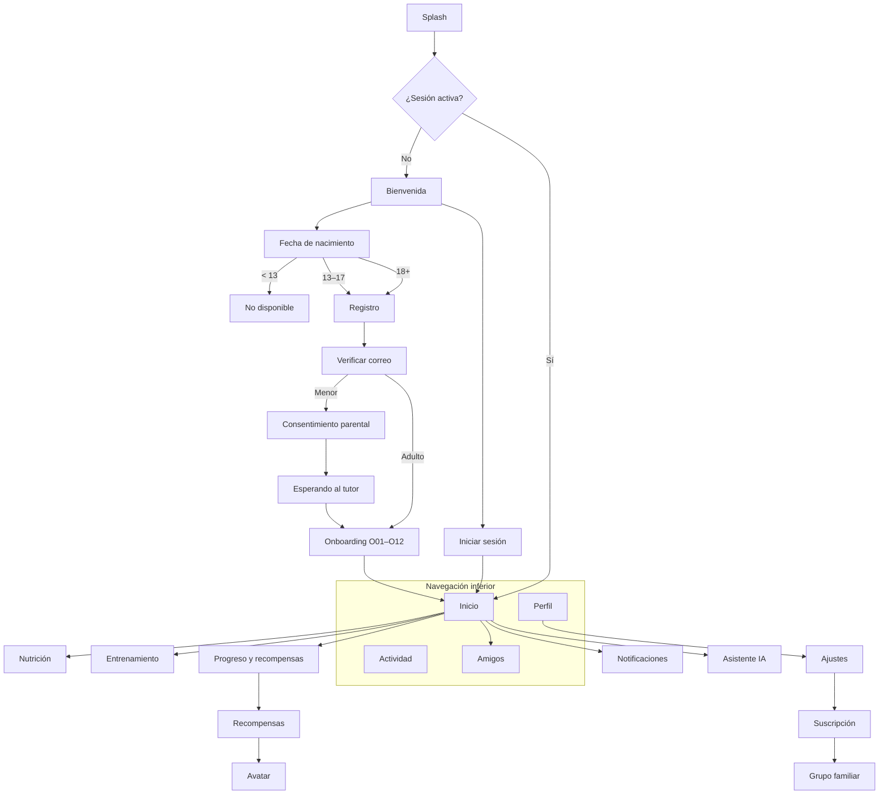
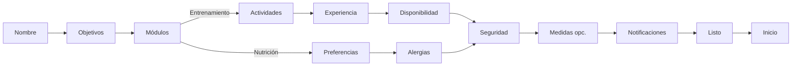
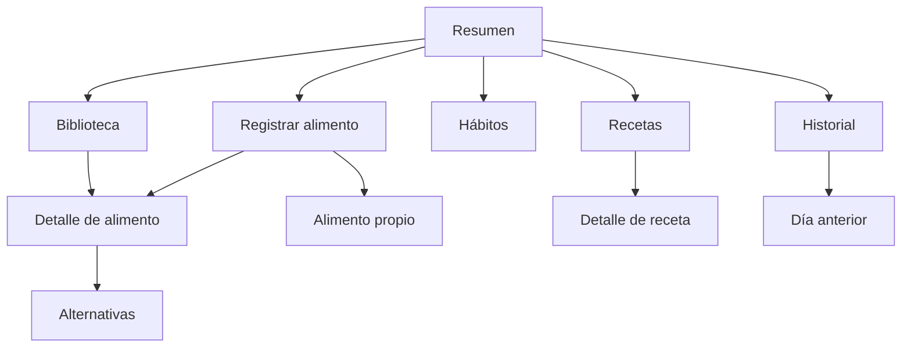
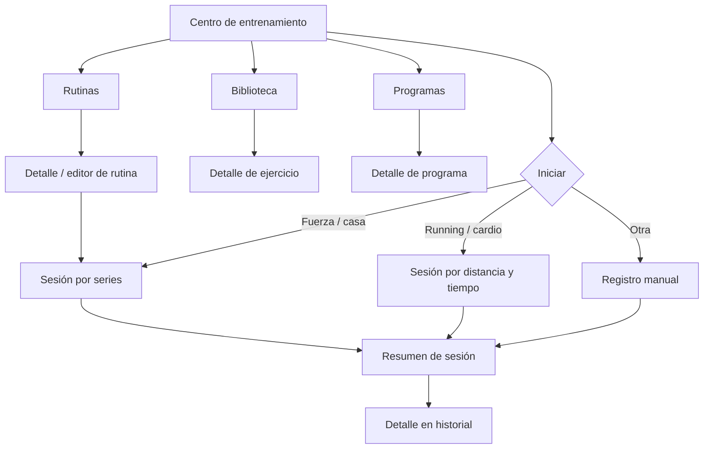
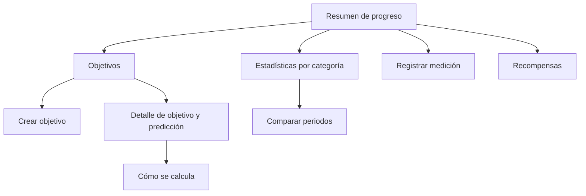
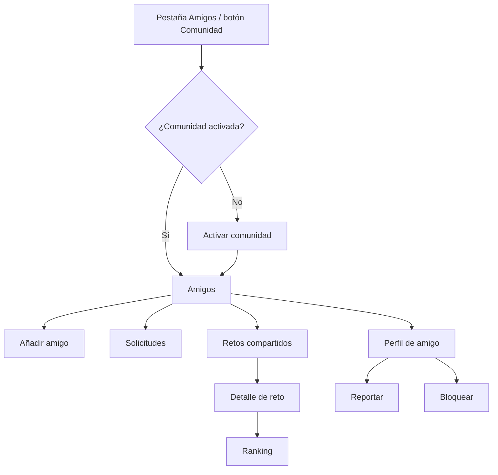
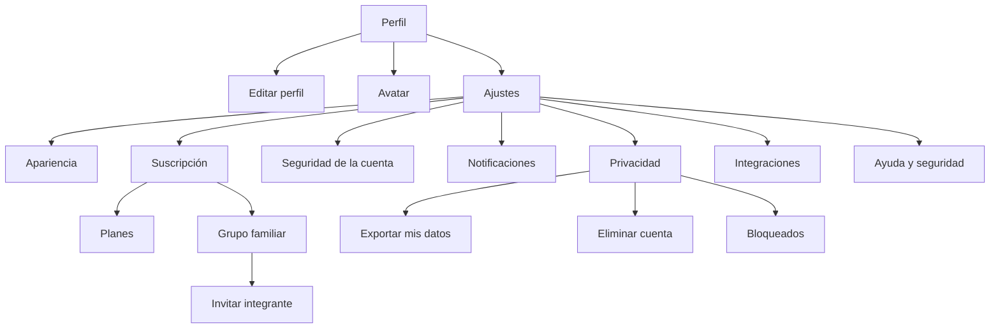

# Definite Fitnes — Mapa de navegación

| | |
|---|---|
| **Versión** | 0.1 (borrador para revisión) |
| **Etapa** | 2 — PRD y mapa de navegación |
| **Documento hermano** | [01-PRD.md](01-PRD.md) |

Este documento describe **todas las pantallas**, sus botones, a dónde lleva cada uno y quién puede verlas. Las etiquetas **[E6]…[E10]** indican la etapa en que se construye cada pantalla. Las referencias RN-xx remiten a las reglas del PRD.

**Columnas "Edad" y "Plan":** `Todos` = sin restricción · `18+` = solo adultos · `Tutor` = requiere permiso del tutor para menores · `P` = alguna parte es Premium (se detalla en la fila).

---

## 1. Estructura general

### 1.1 Navegación inferior (siempre visible en las pantallas principales)

| Pestaña | Pantalla | Contenido |
|---|---|---|
| **Inicio** | H01 | Saludo, accesos a módulos, resumen del día |
| **Actividad** | C01 | Calendario, planificación e historial de todo lo registrado |
| **Amigos** | S01 | Comunidad [E9] (ver decisión D-01 del PRD) |
| **Perfil** | U01 | Perfil, avatar, ajustes, suscripción |

Los cuatro módulos de color (Nutrición, Entrenamiento, Progreso y recompensas, Comunidad) se abren desde los botones grandes del Inicio. La navegación inferior se oculta durante el onboarding y durante una sesión de entrenamiento en curso.

### 1.2 Elementos comunes

- **Botón atrás** en toda pantalla secundaria; gesto de deslizar en iOS y botón del sistema en Android.
- **Botón de acción rápida "+"** flotante en H01 y C01: abre un menú con *Registrar entrenamiento*, *Registrar alimento*, *Registrar medición*, *Planificar actividad* (solo se listan los módulos activos).
- **Estados de cada pantalla:** cargando, vacío (con explicación y botón de primer paso), error (con reintento) y sin conexión (con aviso de que se sincronizará).
- **Confirmación** antes de cualquier acción destructiva (borrar, salir de un grupo, eliminar cuenta).

---

## 2. Acceso y registro [E6]

| ID | Pantalla | Elementos y botones → destino | Edad |
|---|---|---|---|
| **A01** | Splash | Logotipo; comprueba sesión → H01 o A02 | Todos |
| **A02** | Bienvenida | Lemas y 3 láminas de valor · **Crear cuenta** → A03 · **Ya tengo cuenta** → A06 · Enlaces a Términos y Privacidad → A12 | Todos |
| **A03** | Fecha de nacimiento | Selector de fecha · **Continuar** → A04 (13+) o A11 (<13) · Texto: por qué se pide | Todos |
| **A04** | Registro | Correo, contraseña (con indicador de fortaleza y mostrar/ocultar) · Casillas: acepto Términos, acepto Aviso de privacidad, consentimiento expreso para datos de salud · **Crear cuenta** → A05 · *Continuar con Apple / Google* (D-10) | 13+ |
| **A05** | Verificar correo | Campo de código de 6 dígitos · **Verificar** → A09 (menor) u O01 (adulto) · **Reenviar código** (con espera) · **Cambiar correo** → A04 | 13+ |
| **A06** | Iniciar sesión | Correo, contraseña · **Entrar** → H01 (o A10 si falta consentimiento, u onboarding si quedó incompleto) · **Olvidé mi contraseña** → A07 · Apple / Google | Todos |
| **A07** | Recuperar cuenta | Correo · **Enviar instrucciones** → mensaje neutro (RN-06) | Todos |
| **A08** | Nueva contraseña | Se abre desde el enlace del correo · Nueva contraseña ×2 · **Guardar** → A06; cierra las demás sesiones | Todos |
| **A09** | Consentimiento parental | Explicación para el menor · Correo del tutor · **Enviar solicitud** → A10 | 13–17 |
| **A10** | Esperando al tutor | Estado de la solicitud · **Reenviar** · **Cambiar correo del tutor** → A09 · **Cerrar sesión** · **Eliminar mi solicitud** · Al aprobarse → O01 | 13–17 |
| **A11** | No disponible | Mensaje amable; sin formulario ni recogida de datos · **Cerrar** | <13 |
| **A12** | Documentos legales | Términos, Aviso de privacidad, Aviso para madres, padres y tutores | Todos |

### Panel del tutor (web, fuera de la app)

| ID | Pantalla | Elementos y botones | Notas |
|---|---|---|---|
| **T00** | Solicitud de consentimiento | Resumen claro de datos y finalidades · Declaración de ser adulto responsable · **Autorizar** / **Rechazar** | Enlace de un solo uso |
| **T01** | Panel del tutor | Interruptores: Comunidad, Asistente IA, Integraciones de salud, Notificaciones · Solicitudes de amistad pendientes (13–15): **Aprobar** / **Rechazar** · **Solicitar exportación de datos** · **Retirar consentimiento y eliminar cuenta** | RN-115 a RN-117 |

---

## 3. Onboarding [E6]

Una decisión por pantalla, barra de progreso arriba, **Atrás** siempre, **Omitir** en los pasos no esenciales. Las pantallas marcadas *cond.* solo aparecen si se cumple la condición.

| ID | Pantalla | Contenido y botones | Condición | Edad |
|---|---|---|---|---|
| **O01** | ¿Cómo te llamamos? | Nombre o apodo · Preferencia de saludo (RN-17) · **Continuar** | Siempre | Todos |
| **O02** | Tus objetivos | Selección múltiple en tarjetas (lista filtrada por edad, RN-12) · **Continuar** | Siempre | Todos |
| **O03** | ¿Qué quieres usar? | Tarjetas: Entrenamiento, Nutrición, Bienestar y hábitos (mínimo una) · **Continuar** | Siempre | Todos |
| **O04** | Tus actividades | Lista con buscador: gimnasio, running, casa, calistenia, ciclismo, natación, fútbol, otra… · Elegir **modalidad principal** | *cond.* Entrenamiento | Todos |
| **O05** | Tu experiencia | Por cada actividad elegida: empezando / algo de experiencia / con experiencia | *cond.* Entrenamiento | Todos |
| **O06** | Tu disponibilidad | Días por semana, minutos por sesión, lugar habitual y equipo disponible | *cond.* Entrenamiento | Todos |
| **O07** | Preferencias de alimentación | Sin preferencia, vegetariana, vegana, etc. | *cond.* Nutrición | Todos |
| **O08** | Alergias y restricciones | Selección múltiple + campo libre · Aviso RN-24 | *cond.* Nutrición | Todos |
| **O09** | Para cuidarte mejor | Lesiones o condiciones a tener en cuenta (opcional, "prefiero no decir") · Aviso de consultar a un profesional (RN-11) | Si eligió Entrenamiento o Nutrición | Todos |
| **O10** | Medidas (opcional) | Estatura y peso · Explicación de para qué · Unidades · **Omitir** destacado | *cond.* RN-08 | 18+ |
| **O11** | Recordatorios | Explicación del valor · **Activar** → permiso del sistema · **Ahora no** | Siempre | Todos |
| **O12** | Todo listo | Resumen de lo configurado · **Empezar** → H01 | Siempre | Todos |

Si el usuario abandona a medias, al volver continúa donde se quedó.

---

## 4. Inicio [E6]

| ID | Pantalla | Elementos y botones → destino | Etapa |
|---|---|---|---|
| **H01** | Inicio | **Avatar** → U01 · **Campana** → H02 · Saludo · Botón **Nutrición** (morado) → N01 · Botón **Entrenamiento** (amarillo) → E01 · Botón **Progreso y recompensas** (rosa) → P01 · Botón **Comunidad** (gris) → S01 o S02 [E9] · Tarjeta *Hoy* → C02 · Tarjeta *Próximas actividades* → C01; cada actividad → **Empezar** (E06/E07) · Tarjeta *Objetivos* → P04 · Tarjetas de *Recomendaciones* → destino según el caso, con "¿por qué veo esto?" · Botón **Asistente** → I01 [E8] · Botón **+** → menú de registro rápido | E6 |
| **H02** | Notificaciones | Lista agrupada por fecha · Tocar una → su destino · **Marcar todo como leído** · **Ajustes** → U07 | E6 |
| **H03** | Organizar inicio | Mostrar/ocultar tarjetas (Gratis) · Reordenar y tarjetas extra (Premium) · Se abre desde U04 o con pulsación larga en H01 | E10 · P |

---

## 5. Nutrición [E6] — color morado

| ID | Pantalla | Elementos y botones → destino | Edad | Plan |
|---|---|---|---|---|
| **N01** | Resumen nutricional | Selector de día · Resumen (adaptado a la edad, sección 6 del PRD) · Comidas del día con sus alimentos; **Añadir** en cada una → N02 · Tocar un alimento → editar porción o eliminar · Hábitos de hoy (marcar) · **Agua +** · Accesos: **Biblioteca** → N04, **Recetas** → N05, **Historial** → N07, **Hábitos** → N08 · Aviso educativo (RN-26) | Todos | Todos |
| **N02** | Registrar alimento | Buscador · Pestañas: Recientes, Favoritos, Mis alimentos · Resultados → N03 · **Crear alimento** → N10 | Todos | Todos |
| **N03** | Detalle de alimento | Nombre, porción y cantidad · Información nutricional (según edad) · **Fuente del dato** · Advertencia de alérgenos · **Añadir a** [comida] → N01 · **Favorito** · **Ver alternativas** → lista de similares | Todos | Todos |
| **N04** | Biblioteca de alimentos | Buscador, categorías, filtros por preferencias · Resultado → N03 | Todos | Todos |
| **N05** | Recetas | Lista con filtros (tiempo, preferencia, sin alérgenos declarados) · Tarjeta → N06 | Todos | P: catálogo ampliado |
| **N06** | Detalle de receta | Ingredientes, pasos, porciones, valores calculados · **Registrar como comida** → N01 · **Favorito** | Todos | — |
| **N07** | Historial | Calendario y lista por día → vista de ese día · Promedios semanales | Todos | P: análisis por periodos y más de 90 días en gráficos |
| **N08** | Hábitos | Lista de hábitos con su constancia semanal · **Añadir hábito** (de catálogo) · **Editar** recordatorio · **Pausar** / **Archivar** | Todos | Todos |
| **N10** | Alimento propio | Nombre, porción, valores (opcionales) · **Guardar** → N03 · Marca "no verificado" | 16+ | Todos |

---

## 6. Entrenamiento [E6] — color amarillo

| ID | Pantalla | Elementos y botones → destino | Plan |
|---|---|---|---|
| **E01** | Centro de entrenamiento | Selector de disciplina (principal destacada) · **Empezar entrenamiento** → elegir rutina o sesión libre → E06/E07 · **Registrar algo que ya hice** → E08 · Actividad planificada para hoy → **Empezar** · Accesos: **Rutinas** → E04, **Biblioteca** → E02, **Programas** → E10, **Estadísticas** → P05 | Gratis: métricas completas en la modalidad principal |
| **E02** | Biblioteca | Buscador · Filtros: disciplina, zona, equipo, nivel · Elemento → E03 | Todos |
| **E03** | Detalle de ejercicio | Imágenes o animación · Pasos · Músculos · Errores comunes · **Precauciones** (y advertencia personal, RN-34) · Mi historial en este ejercicio → P05 · **Añadir a rutina** → elegir rutina | Todos |
| **E04** | Rutinas | Pestañas: Mis rutinas, Sugeridas · Tarjeta → E05 · **Crear rutina** → E05 vacío | Gratis: hasta 3 propias |
| **E05** | Detalle / editor de rutina | Lista de ejercicios con series y objetivos · **Empezar** → E06/E07 · **Editar**: añadir (→ E02), reordenar, quitar · **Duplicar** · **Planificar** → C03 · **Eliminar** | — |
| **E06** | Sesión en curso — series | Ejercicio actual · Filas de serie: repeticiones, peso, ✔ · Dato de la sesión anterior como referencia · **Temporizador de descanso** · **Añadir serie / ejercicio** · **Ver técnica** → E03 · **Pausar** · **Terminar** → E09 · **Descartar** (confirma) | Todos |
| **E07** | Sesión en curso — cardio | Cronómetro · Campos: distancia, tipo de sesión · **Pausar / Reanudar** · **Terminar** → completar datos → E09 | Todos |
| **E08** | Registro manual | Tipo de actividad · Fecha y hora · Campos **según la disciplina** (RN-28) · Esfuerzo percibido · Notas · **Guardar** → E09 | Todos |
| **E09** | Resumen de sesión | Totales propios de la disciplina · Marcas personales · ¿Cómo te sentiste? · Nota · **Guardar** → C04 · **Compartir** → vista previa [E9, RN-62] · XP obtenido [E7] | Todos |
| **E10** | Programas | Lista por disciplina y nivel · Tarjeta → E11 | P: avanzados y especializados |
| **E11** | Detalle de programa | Semanas y sesiones · **Empezar programa** → se añade al calendario (C01) · **Abandonar programa** | — |

---

## 7. Actividad (pestaña) [E6]

| ID | Pantalla | Elementos y botones → destino | Plan |
|---|---|---|---|
| **C01** | Actividad | Conmutador **Calendario / Historial** · Calendario mensual con marcas por módulo (colores) · Día → C02 · Historial: lista filtrable por tipo → C04 · Botón **+** → menú de registro rápido / **Planificar** → C03 | Todos |
| **C02** | Detalle del día | Planificado y realizado: entrenamientos (→ C04), comidas (→ N01 de ese día), hábitos, mediciones · **Añadir** · **Marcar como día de descanso** (RN-32) | Todos |
| **C03** | Planificar actividad | Tipo (rutina, actividad, descanso) · Fecha y hora · Repetición · Recordatorio · **Guardar** → C01 | P: plantillas semanales y reprogramación automática |
| **C04** | Detalle de sesión | Datos completos de la sesión · **Editar** · **Eliminar** (confirma, RN-31) · **Repetir** → E06/E07 | Todos |

---

## 8. Progreso y recompensas — color rosa

### 8.1 Progreso [E6]

| ID | Pantalla | Elementos y botones → destino | Edad | Plan |
|---|---|---|---|---|
| **P01** | Resumen de progreso | Tarjeta de nivel y XP → G01 [E7] · Objetivos activos → P04 · **Ver todos** → P02 · Categorías: Actividad, Rendimiento, Nutrición, Bienestar, Objetivos → P05 · **Registrar medición** → P07 | Todos | Todos |
| **P02** | Objetivos | Pestañas: Activos, En pausa, Completados · Tarjeta → P04 · **Nuevo objetivo** → P03 | Todos | Gratis: 3 activos |
| **P03** | Crear objetivo | Paso 1: tipo (lista según edad) · Paso 2: métrica, valor meta, fecha deseada opcional · Paso 3: revisión · **Crear** → P04 · Si alcanza el límite del plan → aviso con opción de pausar otro o ver planes (U09) | Todos | — |
| **P04** | Detalle de objetivo | Gráfico de avance con línea de tendencia · **Bloque de predicción**: rango de fechas + calidad de datos + aviso (RN-39), o mensaje de datos insuficientes (RN-38), o de tendencia no favorable (RN-40) · **¿Cómo se calcula?** → P08 · Historial de registros (editar/borrar) · **Registrar avance** → P07 · **Editar** · **Pausar** · **Completar** · **Archivar** | Todos | P: comparar escenarios |
| **P05** | Estadísticas | Selector de categoría, métrica y periodo · Gráficos · Marcas personales · Vista por disciplina con sus métricas | Todos | Gratis: 90 días; P: completo |
| **P06** | Comparar periodos | Dos periodos lado a lado con diferencias | Todos | Premium [E10] |
| **P07** | Registrar medición | Tipo (marca, bienestar, medida corporal 18+ / 16–17 limitado, personalizada) · Valor, fecha, nota · **Guardar** | Según tipo | Todos |
| **P08** | Cómo se calcula | Explicación llana del método, datos usados, significado del rango y de la calidad, límites | Todos | Todos |

### 8.2 Gamificación y avatar [E7]

| ID | Pantalla | Elementos y botones → destino | Plan |
|---|---|---|---|
| **G01** | Recompensas | Nivel, barra de XP · Objetivo semanal · Misiones activas → G03 · Últimos logros → G02 · **Inventario** → G04 · **Mi avatar** → V01 · **Pausar racha** (RN-52) | Todos |
| **G02** | Logros e insignias | Cuadrícula: obtenidos y por obtener (con condición) · Logro → detalle · **Compartir** → vista previa [E9] | Todos |
| **G03** | Retos y misiones | Pestañas: Misiones, Retos personales, Retos compartidos [E9] · Elemento → detalle con progreso y recompensa · **Unirse** / **Abandonar** (sin penalización) | Todos |
| **G04** | Inventario | Accesorios, fondos, temas, insignias · Elemento → **Usar** (→ V01 o U04) | P: cosméticos exclusivos |
| **V01** | Editor de avatar | Vista previa · Categorías: apariencia, vestimenta, accesorios, fondo · Elementos bloqueados muestran cómo obtenerlos · **Guardar** · **Aleatorio** | P: catálogo ampliado |

---

## 9. Comunidad [E9] — color gris

| ID | Pantalla | Elementos y botones → destino | Edad | Plan |
|---|---|---|---|---|
| **S02** | Activar comunidad | Qué es, qué se comparte y qué nunca (RN-63) · Elegir nombre de usuario y qué mostrar · **Activar** → S01 · **Ahora no** → vuelve · Menores: "Pide permiso a tu tutor" → envía solicitud | 13–17: Tutor | Todos |
| **S01** | Amigos | Actividad compartida por amigos (reacciones y ánimos predefinidos) · Lista de amigos → S05 · **Añadir** → S03 · **Solicitudes** (contador) → S04 · **Retos** → S06 · **Privacidad** → U05 | Todos | Todos |
| **S03** | Añadir amigo | Mi código y enlace (**Copiar**, **Compartir**) · Introducir código o nombre de usuario exacto · **Enviar solicitud** | 13–15: aprobación del tutor por cada amistad | Todos |
| **S04** | Solicitudes | Recibidas: **Aceptar** / **Rechazar** / **Bloquear** · Enviadas: **Cancelar** | Todos | Todos |
| **S05** | Perfil de amigo | Avatar, nombre de usuario, nivel, logros compartidos · **Invitar a un reto** · Menú: **Eliminar amigo**, **Bloquear**, **Reportar** → S09 | Todos | Todos |
| **S06** | Retos compartidos | Activos, invitaciones, finalizados · **Crear reto** (plantillas) | 13–15: solo retos de plantilla con amigos aprobados | P: retos personalizados |
| **S07** | Detalle de reto | Reglas, duración, participantes, mi progreso · **Unirse / Salir** · **Ver ranking** → S08 (si está activado) | Todos | — |
| **S08** | Ranking | Posiciones por constancia (RN-65) · **Ocultarme del ranking** | 16+ | Todos |
| **S09** | Reportar | Motivo, detalle opcional · **Enviar** · Opción de bloquear a la vez | Todos | Todos |
| **S10** | Bloqueados | Lista · **Desbloquear** (desde U05) | Todos | Todos |

---

## 10. Asistente de IA [E8]

| ID | Pantalla | Elementos y botones → destino | Edad | Plan |
|---|---|---|---|---|
| **I01** | Asistente | Aviso "Respuestas generadas por IA; no es consejo médico" · Sugerencias de preguntas · Campo de mensaje · Respuestas con enlaces a la pantalla relacionada · Propuestas de acción con **Confirmar / Cancelar** (RN-78) · 👍 👎 **Reportar respuesta** · Contador de mensajes restantes · Menú: **Qué datos puede ver** → I02, **Historial** → I03 | 13–17: Tutor, modo restringido | Límite diario según plan |
| **I02** | Datos del asistente | Interruptores por categoría: entrenamiento, nutrición, progreso, objetivos, bienestar · Explicación de cada uno | Todos | Todos |
| **I03** | Historial | Conversaciones anteriores → abrir · **Borrar una** / **Borrar todo** | Todos | Todos |

Primera vez que se abre I01: se muestra I02 para que el usuario decida qué autoriza.

---

## 11. Perfil y ajustes [E6, salvo indicación]

| ID | Pantalla | Elementos y botones → destino | Etapa |
|---|---|---|---|
| **U01** | Perfil | Avatar (→ V01 [E7]) · Nombre · Nivel [E7] · Plan actual → U08 · Resumen: objetivos, actividades · **Editar perfil** → U02 · **Ajustes** (engranaje) → U03 | E6 |
| **U02** | Editar perfil | Nombre y saludo · Objetivos · **Módulos activos** (activar o desactivar) · Actividades y **modalidad principal** (RN-35) · Experiencia y disponibilidad · Preferencias, alergias · Consideraciones de seguridad · Medidas (18+) · Unidades · Fecha de nacimiento (solo lectura, RN-03) | E6 |
| **U03** | Ajustes | Lista: Apariencia, Privacidad, Seguridad de la cuenta, Notificaciones, Suscripción, Integraciones, Ayuda y seguridad, Legal → A12 · Versión de la app · **Cerrar sesión** | E6 |
| **U04** | Apariencia | Tema: oscuro / claro / según el sistema · Color de acento · Tamaño de texto · Reducir animaciones · Paletas y tarjetas (Premium) · **Organizar inicio** → H03 | E6; ampliado E10 |
| **U05** | Privacidad | Comunidad: activada/desactivada, qué muestra mi perfil, rankings [E9] · Datos del asistente → I02 [E8] · Analítica (consentimiento) · **Bloqueados** → S10 · **Exportar mis datos** → U12 · **Eliminar cuenta** → U13 · Menores: **Mi tutor** → U16 | E6 |
| **U06** | Seguridad de la cuenta | **Cambiar correo** · **Cambiar contraseña** (ambos piden contraseña actual) · Sesiones abiertas: **Cerrar** / **Cerrar todas** · Verificación en dos pasos (posterior) | E6 |
| **U07** | Notificaciones | Interruptores por tipo: recordatorios de actividad, hábitos, objetivos, logros, comunidad, novedades · Horario de silencio | E6 |
| **U08** | Suscripción | Plan actual, fecha de renovación · **Ver planes** → U09 · **Grupo familiar** → U10 · **Gestionar o cancelar** → tienda · **Restaurar compras** | E10 |
| **U09** | Planes | Comparativa Gratis / Premium / Familiar · Precios y condiciones claras · **Elegir** → compra de la tienda · Menores: mensaje RN-97, sin botones de compra | E10 |
| **U10** | Grupo familiar | *Administrador:* integrantes (nombre y estado, nada más — RN-101), lugares libres, **Invitar** → U11, **Retirar integrante**, **Transferir administración** · *Integrante:* quién administra, **Salir del grupo** · *Sin grupo:* **Tengo un código de invitación** | E10 |
| **U11** | Invitar integrante | Generar enlace o código de un solo uso · **Compartir** · Invitaciones pendientes: **Anular** | E10 |
| **U12** | Exportar mis datos | Qué incluye · **Solicitar exportación** (pide contraseña) → aviso cuando el archivo esté listo → **Descargar** | E6 |
| **U13** | Eliminar cuenta | Qué se borra, periodo de gracia de 30 días (RN-87) · Aviso si hay suscripción activa o si administra un grupo familiar · Opción de exportar antes · Contraseña + confirmación · **Eliminar mi cuenta** | E6 |
| **U14** | Ayuda y seguridad | Preguntas frecuentes · **Contactar a soporte** · Recursos de ayuda y crisis · Uso responsable · Reportar un problema · Siempre gratis (RN-91) | E6 |
| **U15** | Integraciones | Apple Health / Health Connect, Spotify, wearables: estado, **Conectar / Desconectar**, permisos por tipo de dato | E10 |
| **U16** | Mi tutor | Quién autorizó la cuenta · Qué puede y no puede ver o hacer · **Compartir resumen semanal** (interruptor, RN-116) · **Pedir permiso** para Comunidad / Asistente | E6 |

---

## 12. Flujos principales paso a paso

**F1 · Registro de un adulto**
A02 → A03 → A04 → A05 → O01…O12 → H01

**F2 · Registro de un menor**
A02 → A03 → A04 → A05 → A09 → A10 *(tutor: T00 autoriza)* → O01…O12 (versión por edad) → H01

**F3 · Registrar un entrenamiento de gimnasio**
H01 → Entrenamiento (E01) → Empezar → elegir rutina (E05) → E06 → Terminar → E09 → Guardar → C04

**F4 · Registrar una carrera ya hecha**
Botón + → Registrar entrenamiento → E08 (campos de running) → E09 → Guardar

**F5 · Registrar una comida**
H01 → Nutrición (N01) → Añadir en "Comida" → N02 → N03 → Añadir → N01

**F6 · Crear un objetivo y ver su predicción**
H01 → Progreso (P01) → P02 → Nuevo objetivo (P03) → P04 *(al principio: "aún no hay datos suficientes"; tras varios registros: rango de fechas y calidad)* → P08

**F7 · Planificar la semana**
Actividad (C01) → + → Planificar (C03) → Guardar → aparece en H01 "Próximas actividades" → Empezar

**F8 · Activar la comunidad y añadir a un amigo [E9]**
Amigos → S02 → Activar → S01 → S03 → enviar código → *(el amigo acepta en S04)*

**F9 · Crear un grupo familiar [E10]**
U01 → U03 → U08 → U09 → elegir Familiar → compra → U10 → U11 → compartir enlace → *(la persona invitada: abre el enlace → inicia sesión o se registra → acepta)*

**F10 · Eliminar la cuenta**
U01 → U03 → U05 → U13 → (exportar opcional, U12) → confirmar → sesión cerrada; 30 días para arrepentirse iniciando sesión

---

## 13. Enlaces directos y notificaciones

| Origen | Destino |
|---|---|
| Recordatorio de actividad planificada | C02 del día, con botón Empezar |
| Recordatorio de hábito | N01 / N08 |
| Objetivo alcanzado o predicción actualizada | P04 |
| Logro obtenido [E7] | G02 |
| Solicitud de amistad o invitación a reto [E9] | S04 / S07 |
| Invitación a grupo familiar [E10] | Pantalla de aceptación → U10 |
| Enlace de recuperación de contraseña | A08 |
| Enlace de consentimiento (tutor) | T00 (web) |
| Exportación lista | U12 |

Si la persona no ha iniciado sesión, primero pasa por A06 y luego llega al destino.

---

## 14. Adaptación a tablets

- **Navegación:** la barra inferior pasa a ser una barra lateral en pantallas anchas.
- **Dos paneles:** lista a la izquierda y detalle a la derecha (por ejemplo, E02 + E03, N04 + N03, P02 + P04, C01 + C02).
- **Inicio:** las tarjetas se distribuyen en dos o tres columnas.
- **Formularios y onboarding:** ancho máximo centrado, para que no se estiren.
- **Orientación:** vertical y horizontal en tablets; vertical en teléfonos (la sesión en curso podrá admitir horizontal más adelante).

---

## 15. Inventario de pantallas

| Grupo | Pantallas | Cantidad | Etapa principal |
|---|---|---|---|
| Acceso | A01–A12 | 12 | E6 |
| Tutor (web) | T00–T01 | 2 | E6 |
| Onboarding | O01–O12 | 12 | E6 |
| Inicio | H01–H03 | 3 | E6 (H03 en E10) |
| Nutrición | N01–N08, N10 | 9 | E6 |
| Entrenamiento | E01–E11 | 11 | E6 |
| Actividad | C01–C04 | 4 | E6 |
| Progreso | P01–P08 | 8 | E6 (P06 en E10) |
| Gamificación y avatar | G01–G04, V01 | 5 | E7 |
| Asistente IA | I01–I03 | 3 | E8 |
| Comunidad | S01–S10 | 10 | E9 |
| Perfil y ajustes | U01–U16 | 16 | E6 (U08–U11, U15 en E10) |
| **Total** | | **95** | |

De ellas, aproximadamente **70 corresponden al MVP (E6)**. Es un número alto: en la Etapa 6 se construirán por bloques (acceso → onboarding → inicio → entrenamiento → progreso → nutrición → perfil), cada uno probado antes de pasar al siguiente.
