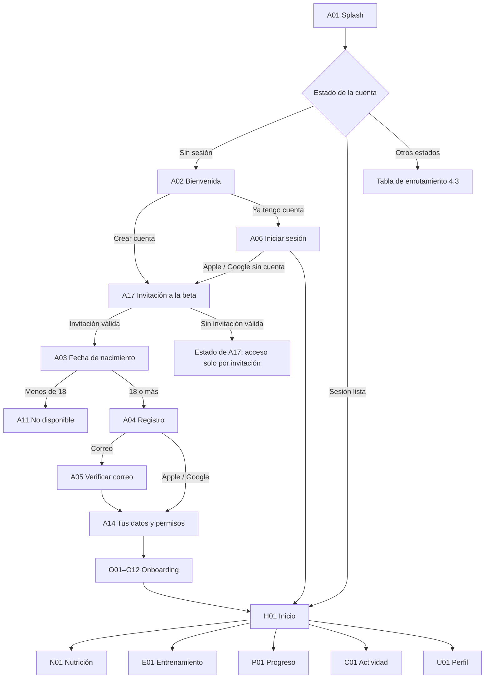
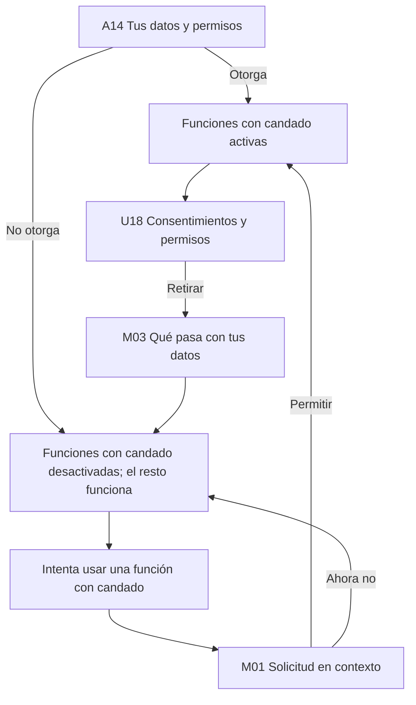
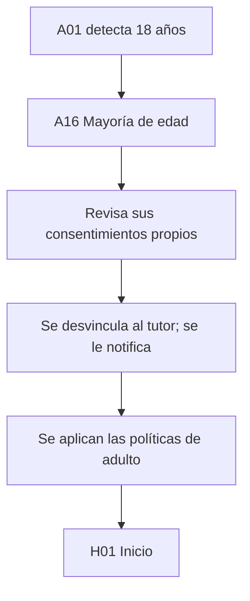
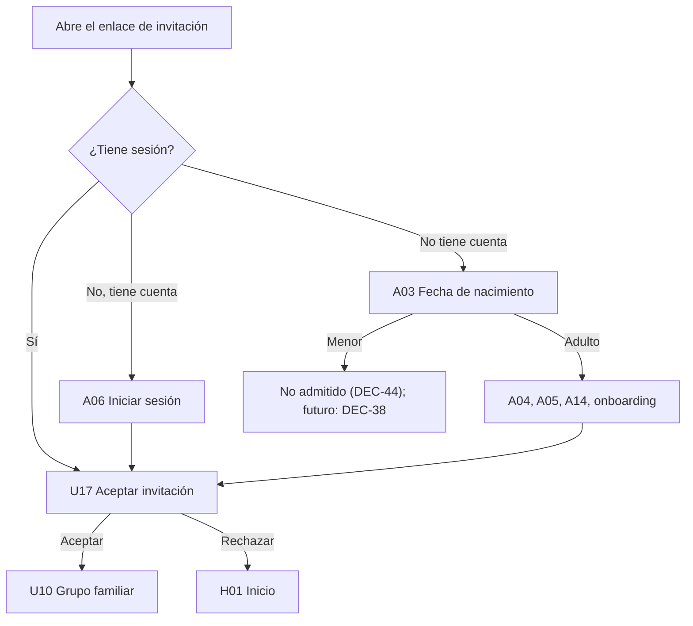

# Definite Fitnes — Mapa de navegación v0.2 (PROPUESTA)

| | |
|---|---|
| **Versión** | 0.2.2 — propuesta |
| **Estado** | **Pendiente de aprobación del propietario. No es definitiva** y no autoriza el inicio del desarrollo. |
| **Sustituye a** | Nada todavía. `docs/02-MAPA-NAVEGACION.md` (v0.1) sigue intacto. Las versiones anteriores se conservan en Git (v0.2: a5d6863; v0.2.1: abb3921). |
| **Documentos relacionados** | [04 — PRD v0.2](04-PRD-v0.2-PROPUESTA.md) · [06 — Registro de decisiones](06-REGISTRO-DECISIONES-v0.2.md) · [07 — Trazabilidad](07-TRAZABILIDAD-AUDITORIA-v0.2.md) |

---

## 0. Historial de cambios

### v0.2.2

1. **AF-06:** etapas con prefijo **ET** (ET6.1, ET10…); las pantallas E01–E11 no cambian.
2. **AF-13:** objetivos corporales de menores marcados como pendientes (DEC-35) en P03 y en la matriz §8.
3. **AF-03:** A14 cita DEC-65. **AF-25:** los valores de las recetas (N06) se identifican como estimación.
4. F26 incluye el requisito previo de documentos legales (DEC-70); §9 remite al servicio de correo transaccional (PRD §8.5, proveedor pendiente DEC-72).
5. Sin cambios en el inventario ni en los conteos.

### v0.2.1

Incorpora solo DEC-68 (beta cerrada, gratuita, por invitación, solo 18+, sin cobros) y DEC-44 (sin menores en la beta ni en el MVP):

1. Nueva pantalla **A17 Invitación a la beta** (β), antes de la fecha de nacimiento.
2. La verificación de edad de la beta exige **18 años o más**; con menos de 18 se muestra A11 (F27).
3. Las pantallas A09, A10, A15, A16 y U16, y las páginas web T01–T04, pasan a **MEN** (habilitación futura de menores): fuera de la beta y del MVP, documentadas sin eliminarse.
4. Flujos F01 y F02 ajustados; nuevos F26 (acceso por invitación) y F27 (menor de 18 en la beta); F03, F07, F16 y F17 marcados como MEN.
5. F21: transición de la beta gratuita a planes comerciales pendiente (DEC-67), con aviso de no gratuidad permanente desde la invitación (RN-141).
6. Conteos actualizados (§3.4).

---

## 1. Convenciones

### 1.1 Prefijos de identificadores

| Prefijo | Grupo | Tipo |
|---|---|---|
| **A** | Acceso, registro, consentimientos y transiciones de cuenta | Pantalla de la app |
| **O** | Onboarding | Pantalla de la app |
| **H** | Inicio | Pantalla de la app |
| **N** | Nutrición | Pantalla de la app |
| **E** | Entrenamiento | Pantalla de la app |
| **C** | Actividad (calendario e historial) | Pantalla de la app |
| **P** | Progreso | Pantalla de la app |
| **G**, **V** | Gamificación, avatar | Pantalla de la app |
| **I** | Asistente de IA | Pantalla de la app |
| **S** | Comunidad | Pantalla de la app |
| **U** | Perfil, ajustes, cuenta y plan | Pantalla de la app |
| **T** | Tutor | **Página web** (fuera de la app) |
| **M** | Diálogos y avisos superpuestos reutilizables | Componente (no cuenta como pantalla) |
| **F** | Flujos | Recorrido |

Los nodos de decisión de los diagramas (rombos) no son pantallas y no llevan prefijo de pantalla.

### 1.2 Marcadores

| Marcador | Significado |
|---|---|
| **ET1–ET11** | Etapas del plan con prefijo ET desde la v0.2.2 (AF-06). Las pantallas de Entrenamiento conservan sus IDs E01–E11 |
| **ET6.1 / ET6.2 / ET6.3** | Entrega interna del MVP |
| **ET7–ET10** | Etapa posterior |
| **POST** | Posterior al MVP, etapa por definir (DEC-59) |
| **◆ MEN** | Habilitación futura de menores y tutores. **Fuera de la beta y del MVP** (DEC-44); se conserva documentada |
| **β** | Solo durante la beta cerrada (DEC-68) |
| **🔒 Salud** | Requiere el consentimiento de datos de salud (categoría según DEC-42) |
| **★** | Función prevista como Premium en ET10 (en v0.1 se usaba "P", que se confundía con Progreso) |
| **[PEND DEC-xx]** | El comportamiento depende de una decisión pendiente |

### 1.3 Equivalencias de identificadores con la v0.1

| v0.1 | v0.2 | Motivo |
|---|---|---|
| T00 Solicitud de consentimiento | **T01** | Numeración desde 01 (I-05) |
| T01 Panel del tutor | **T02** | Ídem |
| — | **T03** Solicitud de permiso, **T04** Gestionar o retirar consentimiento | Fases del tutor (DEC-45) |
| N03b Alternativas (solo en diagrama) | **N09** | Ocupa el hueco N09 (I-03, I-04) |
| N01d Día anterior (solo en diagrama) | Vista de **N01** con otra fecha | No es pantalla propia (I-04) |
| E00 (decisión) | Nodo de decisión sin ID | No es pantalla (I-05) |
| Columna "Plan: P" | **★** | Evita confusión con Progreso (I-01) |
| Todas las demás | Sin cambio | Trazabilidad |

---

## 2. Módulos y submódulos

```
Definite Fitnes
├── Acceso y cuenta (A)
│   ├── Bienvenida, verificación de edad, registro, inicio de sesión, recuperación
│   ├── Consentimientos de datos (A14)
│   ├── Invitación a la beta (A17) β
│   ├── Menores: consentimiento parental y espera ◆ MEN (fuera de la beta)
│   └── Transiciones: eliminación programada; cambio de tramo y mayoría de edad ◆ MEN
├── Tutor (T, web) ◆ MEN — fuera de la beta
├── Onboarding (O)
├── Inicio (H)
├── Nutrición (N) ............................ ET6.3
│   ├── Resumen, registro, base de alimentos, detalle, alternativas, alimento propio
│   ├── Hábitos e historial
│   └── Recetas básicas (biblioteca amplia: POST)
├── Entrenamiento (E) ........................ ET6.2
│   ├── Centro, biblioteca, rutinas
│   ├── Sesión en curso (única función sin conexión) y registro manual
│   └── Programas básicos (extensos: POST; avanzados: ET10)
├── Actividad (C) ............................ ET6.2
├── Progreso (P) ............................. ET6.2
├── Recompensas y avatar (G, V) .............. ET7
├── Asistente IA (I) ......................... ET8
├── Comunidad (S) ............................ ET9
└── Perfil y cuenta (U)
    ├── Perfil, ajustes, apariencia, notificaciones, seguridad ... ET6.1
    ├── Privacidad, consentimientos, exportar, eliminar, ayuda .. ET6.1
    ├── Mi tutor ◆ ............................................. MEN
    └── Suscripción, planes, grupo familiar, integraciones ..... ET10
```

---

## 3. Inventario de pantallas

### 3.1 Pantallas de la app

| ID | Pantalla | Etapa | Cond. | Se accede desde |
|---|---|---|---|---|
| A01 | Splash y enrutamiento | ET6.1 | | Abrir la app |
| A02 | Bienvenida | ET6.1 | | A01 (sin sesión), U03 Cerrar sesión |
| A03 | Fecha de nacimiento | ET6.1 | | A17 (invitación válida) |
| A04 | Registro | ET6.1 | | A03 (edad admitida) |
| A05 | Verificar correo | ET6.1 | | A04 (registro con correo); A01 (correo sin verificar) |
| A06 | Iniciar sesión | ET6.1 | | A02; A08; enlace directo sin sesión |
| A07 | Recuperar cuenta | ET6.1 | | A06 |
| A08 | Nueva contraseña | ET6.1 | | Enlace del correo de recuperación |
| A09 | Consentimiento parental: solicitud | MEN | ◆ | A05 o A04 (menor), cuando se habiliten menores |
| A10 | Esperando al tutor | MEN | ◆ | A09; A01 o A06 (consentimiento pendiente) |
| A11 | No disponible por edad | ET6.1 | | A03 (menos de 18 en la beta); A01 (bloqueo recordado, si se valida) |
| A12 | Documentos legales | ET6.1 | | A02, A04, A14, U03, U18 |
| A13 | Cuenta programada para eliminarse | ET6.1 | | A01 o A06 (cuenta en periodo de gracia) |
| A14 | Tus datos y permisos (consentimientos iniciales) | ET6.1 | | A05; A04 (Apple/Google) |
| A15 | Cambio de tramo de edad | MEN | ◆ | A01 (al detectar el paso de 15 a 16) |
| A16 | Mayoría de edad: tus propios consentimientos | MEN | ◆ | A01 (al cumplir 18 una cuenta de menor) |
| A17 | Invitación a la beta | ET6.1 | β | A02 Crear cuenta; A06 (Apple/Google sin cuenta); enlace de invitación |
| O01 | ¿Cómo te llamamos? | ET6.1 | | A14; A01 (onboarding incompleto) |
| O02 | Tus objetivos | ET6.1 | | O01 |
| O03 | ¿Qué quieres usar? | ET6.1 | | O02 |
| O04 | Tus actividades | ET6.1 | | O03 (Entrenamiento) |
| O05 | Tu experiencia | ET6.1 | | O04 |
| O06 | Tu disponibilidad | ET6.1 | | O05 |
| O07 | Preferencias de alimentación | ET6.1 | | O03 (Nutrición) u O06 |
| O08 | Alergias y restricciones | ET6.1 | 🔒 | O07 |
| O09 | Para cuidarte mejor | ET6.1 | 🔒 | O06 u O08 |
| O10 | Medidas (opcional) | ET6.1 | 🔒 adultos | O09 |
| O11 | Recordatorios | ET6.1 | | O10, O09 u O03 |
| O12 | Todo listo | ET6.1 | | O11 |
| H01 | Inicio | ET6.1 | | O12; A01; A06; pestaña Inicio |
| H02 | Notificaciones | ET6.1 | | H01 (campana) |
| H03 | Organizar inicio | ET10 | ★ | U04; pulsación larga en H01 |
| N01 | Resumen nutricional | ET6.3 | | H01 Nutrición; C02; notificación de hábito |
| N02 | Registrar alimento | ET6.3 | | N01 Añadir; menú + |
| N03 | Detalle de alimento | ET6.3 | | N02, N04, N09 |
| N04 | Base de alimentos | ET6.3 | | N01 |
| N05 | Recetas | ET6.3 | | N01 |
| N06 | Detalle de receta | ET6.3 | | N05 |
| N07 | Historial | ET6.3 | | N01 |
| N08 | Hábitos | ET6.3 | | N01; notificación de hábito |
| N09 | Alternativas | ET6.3 | | N03 Ver alternativas |
| N10 | Alimento propio | ET6.3 | [PEND DEC-36] menores | N02 Crear alimento |
| E01 | Centro de entrenamiento | ET6.2 | | H01 Entrenamiento; menú + |
| E02 | Biblioteca de ejercicios | ET6.2 | | E01; E05 Añadir ejercicio |
| E03 | Detalle de ejercicio | ET6.2 | | E02; E06 Ver técnica |
| E04 | Rutinas | ET6.2 | | E01 |
| E05 | Detalle y editor de rutina | ET6.2 | | E04; E03 Añadir a rutina |
| E06 | Sesión en curso: series | ET6.2 | sin conexión ✔ | E01, E05, H01, C02, C04 |
| E07 | Sesión en curso: cardio | ET6.2 | sin conexión ✔ | E01, E05, H01, C02, C04 |
| E08 | Registro manual | ET6.2 | | E01; menú + |
| E09 | Resumen de sesión | ET6.2 | | E06, E07, E08 |
| E10 | Programas | ET6.2 | básicos; extensos POST; avanzados ★ ET10 | E01 |
| E11 | Detalle de programa | ET6.2 | | E10 |
| C01 | Actividad (calendario e historial) | ET6.2 | | Pestaña Actividad; H01 Próximas actividades |
| C02 | Detalle del día | ET6.2 | | C01; H01 Hoy; notificación de actividad |
| C03 | Planificar actividad | ET6.2 | | C01; E05 Planificar; menú + |
| C04 | Detalle de sesión | ET6.2 | | C01; E09 Guardar; C02 |
| P01 | Resumen de progreso | ET6.2 | | H01 Progreso y recompensas |
| P02 | Objetivos | ET6.2 | | P01 |
| P03 | Crear objetivo | ET6.2 | | P02 |
| P04 | Detalle de objetivo y predicción | ET6.2 | | P01, P02, H01, notificación |
| P05 | Estadísticas | ET6.2 | | P01; E01; E03 |
| P06 | Comparar periodos | ET10 | ★ | P05 |
| P07 | Registrar medición | ET6.2 | medidas 🔒 adultos | P01; P04; menú + |
| P08 | Cómo se calcula | ET6.2 | | P04 |
| G01 | Recompensas | ET7 | | P01 |
| G02 | Logros e insignias | ET7 | | G01; notificación |
| G03 | Retos y misiones | ET7 | | G01 |
| G04 | Inventario | ET7 | | G01 |
| V01 | Editor de avatar | ET7 | | G01; U01 |
| I01 | Asistente | ET8 | [PEND DEC-41] menores | H01 |
| I02 | Datos del asistente | ET8 | | I01 (primera vez y menú); U05 |
| I03 | Historial del asistente | ET8 | | I01 |
| S01 | Amigos | ET9 | [PEND DEC-40] | Pestaña Amigos o H01 (comunidad activada) |
| S02 | Activar comunidad | ET9 | | Pestaña Amigos o H01 (no activada); U05 |
| S03 | Añadir amigo | ET9 | | S01 |
| S04 | Solicitudes | ET9 | | S01; notificación |
| S05 | Perfil de amigo | ET9 | | S01 |
| S06 | Retos compartidos | ET9 | | S01; G03 |
| S07 | Detalle de reto | ET9 | | S06; notificación |
| S08 | Ranking | ET9 | | S07 |
| S09 | Reportar | ET9 | | S05; menú de cualquier contenido compartido |
| S10 | Bloqueados | ET9 | | U05 |
| S11 | Vista previa al compartir | ET9 | | E09 Compartir; G02 Compartir |
| U01 | Perfil | ET6.1 | | Pestaña Perfil; H01 avatar |
| U02 | Editar perfil | ET6.1 | | U01 |
| U03 | Ajustes | ET6.1 | | U01 |
| U04 | Apariencia | ET6.1 | | U03 |
| U05 | Privacidad | ET6.1 | | U03 |
| U06 | Seguridad de la cuenta | ET6.1 | | U03 |
| U07 | Notificaciones | ET6.1 | | U03; H02 Ajustes |
| U08 | Suscripción | ET10 | | U01 (plan actual); U03 |
| U09 | Planes | ET10 | Menores: no aplica en la beta (DEC-44); futuro: DEC-38 | U08; P03 (al alcanzar un límite, ET10) |
| U10 | Grupo familiar | ET10 | | U08 |
| U11 | Invitar integrante | ET10 | | U10 |
| U12 | Exportar mis datos | ET6.1 | | U05; U13 |
| U13 | Eliminar cuenta | ET6.1 | | U05 |
| U14 | Ayuda y seguridad | ET6.1 | | U03; M02; I01 (crisis) |
| U15 | Integraciones | ET10 | [PEND DEC-37] menores | U03 |
| U16 | Mi tutor | MEN | ◆ | U05 (cuenta de menor) |
| U17 | Aceptar invitación familiar | ET10 | [PEND DEC-38] menores | Enlace de invitación; U10 "Tengo un código" |
| U18 | Consentimientos y permisos | ET6.1 | | U05; M01 |
| U19 | Ajuste tras cambio de plan | ET10 | | A01 o notificación tras bajar de plan |

### 3.2 Páginas web para tutores ◆ MEN — fuera de la beta y del MVP

| ID | Página | Fase | Se accede desde |
|---|---|---|---|
| T01 | Solicitud de consentimiento | MEN · fase 1 | Correo enviado desde A09 |
| T02 | Panel del tutor | MEN · fase 2 | Enlace en los correos al tutor |
| T03 | Solicitud de permiso puntual | MEN · fase 1 | Correo generado desde U16 (y desde S02 e I01 cuando existan) |
| T04 | Gestionar o retirar consentimiento | MEN · fase 1 | Enlace al pie de todos los correos al tutor |

### 3.3 Componentes superpuestos (no son pantallas)

| ID | Componente | Etapa | Aparece en |
|---|---|---|---|
| M01 | Solicitud de consentimiento en contexto | ET6.1 | Cualquier función 🔒 sin consentimiento (O08–O10, P07, N03 alérgenos, E05) |
| M02 | Mensaje de cuidado | ET6.3 | N01 ante señales de riesgo (criterios: DEC-61) |
| M03 | Confirmación de acción destructiva | ET6.1 | Borrar, salir, retirar, eliminar |
| M04 | Desconectar integración | ET10 | U15 |

### 3.4 Conteo

| Grupo | IDs | Total | ET6.1 | ET6.2 | ET6.3 | ET7 | ET8 | ET9 | ET10 | MEN |
|---|---|---|---|---|---|---|---|---|---|---|
| Acceso | A01–A17 | 17 | 13 | | | | | | | 4 |
| Onboarding | O01–O12 | 12 | 12 | | | | | | | |
| Inicio | H01–H03 | 3 | 2 | | | | | | 1 | |
| Nutrición | N01–N10 | 10 | | | 10 | | | | | |
| Entrenamiento | E01–E11 | 11 | | 11 | | | | | | |
| Actividad | C01–C04 | 4 | | 4 | | | | | | |
| Progreso | P01–P08 | 8 | | 7 | | | | | 1 | |
| Recompensas y avatar | G01–G04, V01 | 5 | | | | 5 | | | | |
| Asistente | I01–I03 | 3 | | | | | 3 | | | |
| Comunidad | S01–S11 | 11 | | | | | | 11 | | |
| Perfil y cuenta | U01–U19 | 19 | 11 | | | | | | 7 | 1 |
| **Pantallas de la app** | | **103** | **38** | **22** | **10** | **5** | **3** | **11** | **9** | **5** |
| **Páginas web del tutor** | T01–T04 | **4** | | | | | | | | **4** |

Las pantallas de la app y las páginas web se cuentan por separado: son 103 pantallas de la app y 4 páginas web, no "107 pantallas".

- **Beta y MVP (ET6.1 + ET6.2 + ET6.3): 70 pantallas de la app** (38 + 22 + 10) y **ninguna página web**.
- **Solo durante la beta (β):** A17, incluida en las 38 de ET6.1.
- **Habilitación futura de menores (MEN):** 5 pantallas de la app (A09, A10, A15, A16, U16) y 4 páginas web (T01–T04), documentadas y fuera de la beta y del MVP.
- **Respecto a la v0.2:** la v0.2 contaba 74 pantallas de la app en el MVP (69 sin menores) y 3 páginas web. La v0.2.1 cuenta 69 + A17 = 70 y ninguna página web. El total de la app pasa de 102 a 103.
- **Respecto a la v0.1:** 95 (93 de la app + 2 web) → 107 (103 + 4).

---

## 4. Estructura general

### 4.1 Diagrama



Los recorridos de menores (A09, A10, T01) no forman parte de la beta; se conservan en F03 como habilitación futura (MEN).

### 4.2 Navegación inferior por entrega

| Momento | Pestañas visibles |
|---|---|
| ET6.1 (entrega interna) | Inicio · Perfil |
| ET6.2 | Inicio · Actividad · Perfil |
| ET6.3 (MVP completo) | Inicio · Actividad · Perfil, y **Amigos según DEC-46** [PEND] |
| ET9 | Inicio · Actividad · Amigos · Perfil |

La barra se oculta durante el registro, el onboarding y una sesión de entrenamiento en curso.

Los botones grandes de H01 aparecen cuando su módulo está disponible: Entrenamiento y Progreso desde ET6.2, Nutrición desde ET6.3, Comunidad desde ET9 (RN-13, RN-14).

### 4.3 Enrutamiento de A01 (resuelve P-01)

El servidor indica el estado de la cuenta; A01 envía a la primera pantalla aplicable, en este orden:

| N.º | Estado | Destino |
|---|---|---|
| 1 | Bloqueo por edad recordado en el dispositivo [PEND E-12 / VAL] | A11 |
| 2 | Sin sesión | A02 |
| 3 | Cuenta en periodo de eliminación | A13 |
| 4 | Correo sin verificar | A05 |
| 5 | Consentimiento parental pendiente, rechazado o caducado ◆ MEN (no aplica en la beta) | A10 (con el estado correspondiente) |
| 6 | Cumplió 18 años con cuenta de menor ◆ MEN (no aplica en la beta) | A16 |
| 7 | Cambió de tramo de 13–15 a 16–17 ◆ MEN (no aplica en la beta) | A15 |
| 8 | Consentimientos iniciales no revisados | A14 |
| 9 | Onboarding incompleto | Primera pantalla O pendiente |
| 10 | Bajada de plan con elementos por ajustar (ET10) | U19 |
| 11 | Destino de un enlace directo pendiente | Ese destino |
| 12 | Todo correcto | H01 |

A06 aplica la misma tabla tras un inicio de sesión correcto.

### 4.4 Elementos comunes

- **Botón atrás** en toda pantalla secundaria.
- **Menú "+"** en H01 y C01 con los registros de los módulos disponibles: registrar entrenamiento, registrar alimento (ET6.3), registrar medición, planificar actividad.
- **M03** antes de cualquier acción destructiva.

---

## 5. Pantallas por módulo

### 5.1 Acceso y cuenta [ET6.1]

| ID | Elementos y botones → destino | Estados |
|---|---|---|
| **A01** | Logotipo; aplica la tabla 4.3 | Carga · Sin conexión (reintentar) |
| **A02** | Lemas y láminas de valor · Mención "Beta cerrada" · **Crear cuenta** → A17 · **Ya tengo cuenta** → A06 · Legal → A12 | — |
| **A03** | Selector de fecha neutro · **Continuar** → A04 (18 o más) o A11 (menos de 18, RN-142) · Texto: por qué se pide. Si viene de Apple/Google, conserva la identidad sin crear la cuenta (RN-128) | Fecha inválida |
| **A04** | **Continuar con Apple** · **Continuar con Google** · o correo y contraseña (indicador de fortaleza) · Casillas obligatorias: **Acepto los Términos** (incluidos los Términos de la beta, con el aviso de RN-141) y **He leído el Aviso de privacidad** (→ A12). **No incluye el consentimiento de salud** (RN-129) · **Crear cuenta** → A05 (correo) o A14 (Apple/Google) | Correo inválido · Contraseña débil · Error de red |
| **A05** | Código de 6 dígitos · **Verificar** → A14 · **Reenviar** (con espera) · **Cambiar correo** → A04 | Código incorrecto · Código caducado · Demasiados intentos |
| **A06** | Apple · Google · correo y contraseña · **Entrar** → tabla 4.3 · **Olvidé mi contraseña** → A07. Apple/Google sin cuenta → A17 → A03 (RN-128, RN-143) | Credenciales incorrectas (mensaje neutro, RN-06) · **Demasiados intentos: espera de N minutos** (RN-07) |
| **A07** | Correo · **Enviar instrucciones** → mensaje neutro | Demasiados intentos |
| **A08** | Nueva contraseña ×2 · **Guardar** → A06; cierra las demás sesiones | Enlace caducado → A07 |
| **A09** ◆ MEN | Explicación para el menor · Correo del tutor · **Enviar solicitud** → A10 · Contenido legal: [PEND DEC-30] | Correo inválido · Mismo correo que el del menor |
| **A10** ◆ MEN | **Pendiente:** fecha de caducidad visible (RN-04) · **Reenviar** · **Cambiar correo del tutor** → A09 · **Cancelar solicitud y eliminar mis datos** (M03) · **Cerrar sesión**. **Rechazado:** explicación neutra; los datos se eliminan; **Cerrar**. **Caducado:** explicación; **Volver a solicitar** → A09 o **Cerrar** | Tres estados descritos |
| **A11** | Mensaje amable; durante la beta: "Por ahora, la beta de Definite Fitnes es solo para personas mayores de 18 años" (RN-142, texto propuesto); sin formulario ni recogida de datos; no sugiere cambiar la fecha · **Cerrar**. Si el dispositivo recuerda el bloqueo, A03 no permite reintentar [PEND E-12] | — |
| **A12** | Términos · **Términos de la beta** β (con RN-141) · Aviso de privacidad · Aviso para tutores ◆ MEN · versión y fecha de cada documento | — |
| **A13** | "Tu cuenta se eliminará el [fecha]" · **Reactivar mi cuenta** → tabla 4.3 · **Mantener la eliminación** → cierra sesión | — |
| **A14** | Explicación por capas · Interruptores por categoría (propuesta según DEC-42): **Datos de salud** (alergias, consideraciones de seguridad, medidas) con la lista de funciones que dependen de ellos · **Analítica de uso** (desactivada por defecto, RN-133; DEC-65 pendiente) · Enlaces a A12 · **Continuar** → O01 (con cualquier combinación, incluida "ninguno") · Menores ◆ MEN: categorías según DEC-34 | — |
| **A15** ◆ MEN | Contenido pendiente de DEC-32/DEC-33: qué cambia al pasar a 16–17 · **Entendido** → H01. Aviso al tutor por correo | — |
| **A16** ◆ MEN | "Ahora tu cuenta es tuya": explicación de la desvinculación del tutor · Revisión de consentimientos propios (como A14) · **Continuar** → H01. El tutor deja de tener funciones; se le notifica [PEND DEC-39] | — |
| **A17** β | Qué es la beta: cerrada, gratuita y por invitación · **Aviso: la gratuidad de la beta no es permanente** (RN-141) · Campo **código de invitación** (llega rellenado si se abre desde un enlace) · **Continuar** → A03 · **No tengo invitación** → explicación [PEND DEC-69] · **Ya tengo cuenta** → A06 | Código inválido · Código usado o caducado [PEND DEC-69] · Demasiados intentos |

### 5.2 Tutor (web) ◆ MEN — fuera de la beta y del MVP

| ID | Elementos y botones | Estado |
|---|---|---|
| **T01** | Resumen claro de datos y finalidades · Declaración de ser adulto responsable · Método de verificación [PEND DEC-31] · **Autorizar** / **Rechazar** | Enlace de un solo uso; caducado o ya usado → mensaje |
| **T02** | Panel con todos los permisos, solicitudes y derechos · Contenido: [PEND DEC-39] | Fase 2 (POST) |
| **T03** | Qué pide el menor (por ejemplo, activar una función) y qué implica · **Permitir** / **No permitir** | Enlace de un solo uso |
| **T04** | Ver qué autorizó · **Retirar consentimiento** (desactiva la cuenta e inicia la eliminación) · **Solicitar copia de los datos** (fase 1: vía soporte) | Enlace seguro |

### 5.3 Onboarding [ET6.1]

Una decisión por pantalla, barra de progreso, **Atrás** siempre y **Omitir** en los pasos no esenciales. Al reanudar, continúa donde se quedó.

| ID | Contenido y botones | Condición | Edad |
|---|---|---|---|
| **O01** | Nombre o apodo · Variante de saludo neutro [PROP RN-17] · **Continuar** | Siempre | Todos |
| **O02** | Objetivos en tarjetas, lista según tramo; sin objetivos estéticos para menores (DEC-13); resto [PEND DEC-32/33] | Siempre | Todos |
| **O03** | Entrenamiento · Nutrición · Bienestar y hábitos [PEND DEC-54] · mínimo uno | Siempre | Todos |
| **O04** | Actividades con buscador · Elegir modalidad principal (solo personaliza en el MVP, RN-35). Si no tiene métricas propias aún: aviso de registro genérico [PEND DEC-55] | Entrenamiento | Todos |
| **O05** | Experiencia por actividad | Entrenamiento | Todos |
| **O06** | Días, minutos, lugar, equipo | Entrenamiento | Todos |
| **O07** | Preferencias de alimentación | Nutrición | [PEND DEC-36] menores |
| **O08** | Alergias y restricciones 🔒 · aviso RN-24. **Sin consentimiento:** se omite y se explica cómo activarlo después (M01) | Nutrición | [PEND DEC-34/36] menores |
| **O09** | Consideraciones de seguridad 🔒 · "prefiero no decir" · aviso de consultar a un profesional. **Sin consentimiento:** se omite; se mostrarán las precauciones generales | Entrenamiento o Nutrición | [PEND DEC-34] menores |
| **O10** | Estatura y peso 🔒 · **Omitir** destacado | Adultos con consentimiento y una función que lo use | Adultos; menores [PEND DEC-35] |
| **O11** | Explicación del valor de los recordatorios · **Activar** → permiso del sistema · **Ahora no** (RN-135) | Hay recordatorios disponibles en la entrega | Todos |
| **O12** | Resumen de lo configurado y de los consentimientos · **Empezar** → H01 | Siempre | Todos |

### 5.4 Inicio

| ID | Elementos y botones → destino | Etapa |
|---|---|---|
| **H01** | Avatar → U01 · Campana → H02 · **"Bienvenido, [nombre], ¿qué planeas hacer?"** · Botones de módulo disponibles: **Nutrición** → N01 (ET6.3) · **Entrenamiento** → E01 (ET6.2) · **Progreso y recompensas** → P01 (ET6.2) · **Comunidad** → S01/S02 (ET9) · Tarjetas: Hoy → C02 · Próximas actividades → C01 / **Empezar** → E06/E07 · Objetivos → P04 · Recomendaciones con "¿por qué veo esto?" (incluida la sugerencia de descanso, RN-15/RN-33) · Asistente → I01 (ET8) · Menú + | ET6.1 |
| **H02** | Notificaciones por fecha · tocar → su destino · **Marcar todo como leído** · **Ajustes** → U07 | ET6.1 |
| **H03** | Mostrar, ocultar y reordenar tarjetas ★ | ET10 |

**Estado vacío de H01 en ET6.1:** sin módulos disponibles todavía, muestra el saludo, el perfil y un mensaje "Pronto podrás registrar tus entrenamientos aquí". Solo existe en la entrega interna.

### 5.5 Nutrición [ET6.3] — morado

| ID | Elementos y botones → destino | Edad |
|---|---|---|
| **N01** | Selector de día (días anteriores = misma pantalla con otra fecha) · Resumen (contenido según DEC-36 para menores) · Comidas con **Añadir** → N02 · Tocar alimento → editar porción o eliminar (M03) · Hábitos de hoy · **Agua +** · **Base de alimentos** → N04 · **Recetas** → N05 · **Historial** → N07 · **Hábitos** → N08 · Aviso educativo (RN-26) · M02 si hay señales de riesgo | Menores [PEND DEC-36] |
| **N02** | Buscador · Recientes · Favoritos · Mis alimentos · resultado → N03 · **Crear alimento** → N10 | |
| **N03** | Porción y cantidad · Información nutricional con **fuente** · "Sin dato" donde falte (RN-19) · Estimaciones identificadas (RN-137) · Alérgenos 🔒 (sin consentimiento: aviso general + M01) · **Añadir a** [comida] → N01 · **Favorito** · **Ver alternativas** → N09 | Menores [PEND DEC-36] |
| **N04** | Base de alimentos acotada (DEC-05) · categorías · filtros → N03 · Estado vacío de búsqueda: "No encontramos ese alimento. Puedes crear uno propio" → N10 | |
| **N05** | Recetas básicas con filtros → N06 · Biblioteca amplia: POST | |
| **N06** | Ingredientes, pasos, porciones · valores nutricionales **estimados** a partir de los ingredientes, identificados como estimación (RN-137), con la fuente de cada ingrediente · **Registrar como comida** → N01 · **Favorito** | |
| **N07** | Calendario y lista por día → N01 con esa fecha · promedios semanales | |
| **N08** | Hábitos con constancia semanal · **Añadir** · **Editar recordatorio** · **Pausar** · **Archivar** | Acceso sin Nutrición: [PEND DEC-54] |
| **N09** | Alimentos similares de la misma categoría con comparación neutral (RN-23) · elemento → N03 | |
| **N10** | Nombre, porción, valores opcionales · marca "no verificado" · **Guardar** → N03 | [PEND DEC-36] menores |

### 5.6 Entrenamiento [ET6.2] — amarillo

| ID | Elementos y botones → destino | Notas |
|---|---|---|
| **E01** | Selector de disciplina · **Empezar entrenamiento** → E06/E07 (requiere conexión) · **Registrar algo que ya hice** → E08 · Planificado para hoy → **Empezar** · **Rutinas** → E04 · **Biblioteca** → E02 · **Programas** → E10 · **Estadísticas** → P05 | Edad: [PEND DEC-32/33] |
| **E02** | Buscador · filtros (disciplina, zona, equipo, nivel) → E03 | |
| **E03** | Imágenes · pasos · músculos · errores comunes · **precauciones generales (siempre)** · advertencia personal 🔒 (RN-34) · Mi historial → P05 · **Añadir a rutina** → E05 | |
| **E04** | Mis rutinas · Sugeridas → E05 · **Crear rutina** → E05 | Sin límite en el MVP (DEC-01) |
| **E05** | Ejercicios con series y objetivos · **Empezar** → E06/E07 · **Editar** (añadir → E02, reordenar, quitar) · advertencia al añadir un ejercicio sensible 🔒 · **Duplicar** · **Planificar** → C03 · **Eliminar** (M03) | |
| **E06** | Ejercicio actual · series (repeticiones, peso, ✔) · referencia anterior · temporizador · **Añadir serie / ejercicio** · **Ver técnica** → E03 · **Pausar** · **Terminar** → E09 · **Descartar** (M03) · indicador "Sin conexión: se guardará al reconectar" | Funciona sin conexión una vez iniciada (RN-30) |
| **E07** | Cronómetro · distancia · tipo de sesión · **Pausar / Reanudar** · **Terminar** → E09 · indicador de sin conexión | Funciona sin conexión una vez iniciada |
| **E08** | Tipo de actividad · fecha y hora · campos según disciplina · esfuerzo · notas · **Guardar** → E09 | Requiere conexión |
| **E09** | Totales de la disciplina · marcas · ¿cómo te sentiste? · sugerencia de descanso si aplica (RN-33) · **Guardar** → C04 · **Compartir** → S11 (ET9) · XP (ET7). **Pendiente de envío:** si se terminó sin conexión, muestra "Se enviará al reconectar" y reintenta automáticamente | |
| **E10** | Programas básicos por disciplina y nivel → E11 · extensos POST · avanzados ★ ET10 | Cantidad: DEC-63 |
| **E11** | Semanas y sesiones · **Empezar programa** → C01 · **Abandonar programa** (M03, sin penalización) | |

### 5.7 Actividad [ET6.2]

| ID | Elementos y botones → destino |
|---|---|
| **C01** | Conmutador Calendario / Historial · marcas por módulo · día → C02 · historial filtrable → C04 · **+** → menú / **Planificar** → C03 |
| **C02** | Planificado y realizado · entrenamientos → C04 · comidas → N01 (ET6.3) · hábitos · mediciones · **Añadir** · **Marcar como día de descanso** (RN-32) |
| **C03** | Tipo (rutina, actividad, descanso) · fecha y hora · repetición · recordatorio · **Guardar** → C01. Plantillas semanales ★ ET10 |
| **C04** | Datos completos · **Editar** · **Eliminar** (M03, RN-31) · **Repetir** → E06/E07 |

### 5.8 Progreso [ET6.2] — rosa

| ID | Elementos y botones → destino | Edad |
|---|---|---|
| **P01** | Objetivos activos → P04 · **Ver todos** → P02 · categorías → P05 · **Registrar medición** → P07 · Recompensas → G01 (ET7) | |
| **P02** | Activos · En pausa · Completados → P04 · **Nuevo objetivo** → P03 | Sin límite en el MVP |
| **P03** | Tipo (lista según tramo) · métrica, meta, fecha deseada opcional · revisión · **Crear** → P04. Si una meta de adulto incumple los límites de seguridad (DEC-50), se explica y se propone un ritmo seguro. En ET10: aviso de límite de plan → U09 (adultos) | Menores (MEN): sin objetivos estéticos ni restrictivos (DEC-13); otros objetivos corporales [PEND DEC-35] |
| **P04** | Gráfico con tendencia · **predicción**: rango + calidad + aviso (RN-39) · fecha del último cálculo (RN-42) · o "datos insuficientes, faltan N registros" (RN-38) · o tendencia no favorable (RN-40) · o rango demasiado amplio (RN-41) · **¿Cómo se calcula?** → P08 · registros (editar, borrar) · **Registrar avance** → P07 · **Editar** · **Pausar** · **Completar** · **Archivar** | Sin predicción corporal para menores (DEC-14) |
| **P05** | Categoría, métrica, periodo · gráficos · marcas · vista por disciplina | Historial completo en el MVP |
| **P06** | Dos periodos lado a lado ★ | ET10 |
| **P07** | Tipo: marca, bienestar, personalizada, **medida corporal** 🔒 (adultos; menores [PEND DEC-35]) · valor, fecha, nota · **Guardar** | |
| **P08** | Método, datos usados, significado del rango y de la calidad, límites | |

### 5.9 Recompensas y avatar [ET7]

| ID | Elementos y botones → destino |
|---|---|
| **G01** | Nivel y XP · objetivo semanal · misiones → G03 · logros → G02 · **Inventario** → G04 · **Mi avatar** → V01 · **Pausar racha** |
| **G02** | Obtenidos y por obtener · detalle · **Compartir** → S11 (ET9) |
| **G03** | Misiones · retos personales · retos compartidos → S06 (ET9) · **Unirse / Abandonar** sin penalización |
| **G04** | Accesorios, fondos, temas, insignias · **Usar** → V01 o U04 · exclusivos ★ |
| **V01** | Vista previa · apariencia, vestimenta, accesorios, fondo · bloqueados con cómo obtenerlos · **Guardar** · **Aleatorio** |

### 5.10 Asistente de IA [ET8]

| ID | Elementos y botones → destino |
|---|---|
| **I01** | Aviso "Respuestas generadas por IA; no es consejo médico" · sugerencias · campo de mensaje · enlaces a pantallas · acciones con **Confirmar / Cancelar** · valorar y **Reportar** · mensajes restantes · **Qué datos puede ver** → I02 · **Historial** → I03 · crisis → U14. Menores: [PEND DEC-41] |
| **I02** | Interruptores por categoría de datos (solo categorías con consentimiento otorgado) |
| **I03** | Conversaciones · **Borrar una / todo** (M03) |

### 5.11 Comunidad [ET9] — gris

Todo el módulo depende de DEC-40 (moderación y seguridad) y, para menores, de DEC-32/33.

| ID | Elementos y botones → destino |
|---|---|
| **S01** | Actividad compartida por amigos · amigos → S05 · **Añadir** → S03 · **Solicitudes** → S04 · **Retos** → S06 · **Privacidad** → U05 |
| **S02** | Qué es, qué se comparte y qué nunca (RN-63) · nombre de usuario · **Activar** → S01 · **Ahora no** · Menores: solicitud de permiso → T03 [PEND] |
| **S03** | Mi código y enlace · introducir código o nombre de usuario exacto · **Enviar solicitud** |
| **S04** | Recibidas: **Aceptar / Rechazar / Bloquear** · Enviadas: **Cancelar** |
| **S05** | Avatar, nombre de usuario, nivel, logros compartidos · **Invitar a un reto** · **Eliminar amigo** · **Bloquear** (M03) · **Reportar** → S09 |
| **S06** | Activos, invitaciones, finalizados · **Crear reto** (personalizados ★) → S07 |
| **S07** | Reglas, duración, participantes, progreso · **Unirse / Salir** · **Ver ranking** → S08 |
| **S08** | Posiciones por constancia · **Ocultarme del ranking** |
| **S09** | Motivo · detalle opcional · **Enviar** · opción de bloquear a la vez |
| **S10** | Bloqueados · **Desbloquear** |
| **S11** | Vista exacta de lo que verán los amigos · qué datos se incluyen · **Compartir** / **Cancelar**. Nunca incluye datos de salud (RN-63) |

### 5.12 Perfil y cuenta

| ID | Elementos y botones → destino | Etapa |
|---|---|---|
| **U01** | Avatar o inicial (foto: [PEND DEC-56]) · nombre · plan (ET10) → U08 · **Editar perfil** → U02 · **Ajustes** → U03 · avatar → V01 (ET7) | ET6.1 |
| **U02** | Nombre y saludo · objetivos · **módulos activos** · actividades y modalidad principal · experiencia y disponibilidad · preferencias · alergias 🔒 · consideraciones 🔒 · medidas 🔒 (adultos) · unidades · fecha de nacimiento (solo lectura) | ET6.1 |
| **U03** | Apariencia · Privacidad · Seguridad · Notificaciones · Suscripción (ET10) · Integraciones (ET10) · Ayuda · Legal → A12 · versión · **Cerrar sesión** → A02 | ET6.1 |
| **U04** | Tema oscuro (tema claro: POST) · color de acento · tamaño de texto · reducir animaciones · paletas y tarjetas ★ (ET10) · **Organizar inicio** → H03 (ET10) | ET6.1 |
| **U05** | **Consentimientos y permisos** → U18 · Comunidad (ET9) · Datos del asistente → I02 (ET8) · **Bloqueados** → S10 (ET9) · **Exportar** → U12 · **Eliminar cuenta** → U13 · **Mi tutor** → U16 ◆ MEN | ET6.1 |
| **U06** | Cambiar correo · cambiar contraseña (reautenticación) · sesiones abiertas: **Cerrar / Cerrar todas** | ET6.1 |
| **U07** | Interruptores por tipo de notificación · horario de silencio (menores: [PEND DEC-32/33]) | ET6.1 |
| **U08** | Plan actual · renovación · **Ver planes** → U09 · **Grupo familiar** → U10 · **Gestionar o cancelar** → tienda · **Restaurar compras** | ET10 |
| **U09** | Comparativa de planes y condiciones · **Elegir** → tienda · menores: no aplica en la beta (DEC-44); futuro: DEC-38 | ET10 |
| **U10** | Administrador: integrantes (nombre, estado, fecha; nada más), lugares libres, **Invitar** → U11, **Retirar** (M03), **Transferir administración**, aviso de espera entre grupos [PEND DEC-49] · Integrante: administrador, **Salir del grupo** (M03) · Sin grupo: **Tengo un código** → U17 | ET10 |
| **U11** | Generar enlace o código de un solo uso · **Compartir** · pendientes: **Anular** | ET10 |
| **U12** | Qué incluye · **Solicitar exportación** (reautenticación) · aviso cuando esté lista · **Descargar** | ET6.1 |
| **U13** | Qué se borra · periodo de gracia (RN-87) · avisos si hay suscripción o grupo familiar (ET10) · **Exportar antes** → U12 · contraseña + **Eliminar mi cuenta** (M03) | ET6.1 |
| **U14** | Preguntas frecuentes · **Contactar a soporte** · recursos de ayuda y crisis de México · **Ejercer mis derechos ARCO** (RN-90) · reportar un problema | ET6.1 |
| **U15** | Apple Health / Health Connect, Spotify: estado · **Conectar** (permiso del sistema + consentimiento 🔒) · **Desconectar** → M04 | ET10 |
| **U16** ◆ MEN | Quién autorizó la cuenta · qué puede y no puede hacer el tutor [PEND DEC-39] · **Pedir permiso** para una función → correo → T03 · estado de las solicitudes · resumen para el tutor [PEND DEC-39] | MEN |
| **U17** | Quién invita · qué implica (solo se comparte la suscripción; nadie verá tus datos) · aviso si ya paga Premium (RN-107) · **Aceptar** → U10 · **Rechazar**. Sin sesión: A06 o registro (A03…) y vuelve aquí. Menores: [PEND DEC-38] | ET10 |
| **U18** | Lista de consentimientos con estado y fecha · **Otorgar** / **Retirar** (M03 con explicación de qué pasa con los datos ya guardados, RN-139) · analítica · enlaces a A12 · **Ejercer derechos ARCO** → U14 | ET6.1 |
| **U19** | "Tu plan cambió": elementos que exceden el plan Gratis · elegir cuáles mantener activos; el resto queda en solo lectura (RN-92) · **Exportar** → U12 · **Ver planes** → U09 | ET10 |

---

## 6. Estados comunes

| Estado | Comportamiento | Dónde |
|---|---|---|
| **Cargando** | Esqueleto de la pantalla; sin bloqueos largos | Todas |
| **Vacío** | Explicación y botón de primer paso | Listas, historiales, objetivos, H01 |
| **Error** | Mensaje claro y **Reintentar**; nunca pierde lo escrito sin avisar | Todas |
| **Sin conexión** | Aviso "Necesitas conexión para esto" con **Reintentar**. **Excepción:** E06/E07 siguen funcionando y guardan en el teléfono (RN-30) | Todas salvo E06/E07 |
| **Pendiente de envío** | "Se enviará al reconectar" con reintento automático | E09 |
| **Requiere consentimiento** | M01: qué datos, para qué, **Permitir** / **Ahora no**; nunca insistente | Funciones 🔒 |
| **No disponible para tu edad** | Mensaje neutral (RN-126) | Funciones restringidas por políticas |
| **Requiere permiso del tutor** ◆ MEN | Explicación + **Pedir permiso** → T03 | Funciones que el tutor autoriza |
| **Todavía no disponible** | Solo en entregas internas: la función llega en una entrega posterior | ET6.1, ET6.2 |
| **Demasiados intentos** | Tiempo de espera visible | A05, A06, A07, A17 |
| **Enlace caducado o usado** | Explicación y cómo obtener uno nuevo | A08, A17, U17; T01 y T03 (MEN) |

### 6.1 Transiciones

- Cambio de pestaña: sin animación de desplazamiento; cambio de pantalla dentro de un módulo: deslizamiento lateral; diálogos M: aparecen desde abajo. Todas se reducen a un fundido si el usuario activa "reducir animaciones". El detalle visual corresponde a la Etapa 3. [PROP]
- Al terminar una sesión, el resumen (E09) aparece sin que la barra inferior reaparezca hasta guardar.

---

## 7. Flujos principales

### Registro y acceso

**F01 · Registro de adulto con correo** [ET6.1]
A02 → A17 → A03 → A04 (correo) → A05 → A14 → O01…O12 → H01

**F02 · Registro de adulto con Apple o Google** [ET6.1] (DEC-09)
A02 → A17 → A03 → A04 (Apple/Google) → A14 → O01…O12 → H01
Variante desde A06: Apple/Google sin cuenta → **A17** → **A03** → A04 → A14 → …

**F03 · Registro de menor** ◆ MEN — fuera de la beta y del MVP (DEC-44); documentado para la habilitación futura
A02 → A03 → A04 → A05 → A09 → A10 → *(tutor: correo → T01)*
- Tutor autoriza → A14 (categorías según DEC-34) → O01…O12 → H01
- Tutor rechaza → A10 estado "rechazado" → datos eliminados
- Caduca → A10 estado "caducado" → volver a solicitar (A09) o cerrar

**F04 · Recuperación de cuenta** [ET6.1]
A06 → A07 → *(correo)* → A08 → A06 → tabla 4.3

**F26 · Acceso a la beta por invitación** [ET6.1] (DEC-68)
Requisito previo para invitar a usuarios reales: documentos legales validados y publicados en A12 (DEC-70, RN-144).
Enlace o código de invitación → A17 → código válido → A03 → F01 o F02. Código inválido, usado o caducado → estado de A17. Sin invitación → A17 explica que la beta es por invitación [PEND DEC-69].

**F27 · Persona menor de 18 intenta registrarse en la beta** [ET6.1] (DEC-44)
A17 → A03 → fecha con menos de 18 años → A11 ("la beta es solo para personas mayores de 18"). No se crea cuenta ni se guardan datos personales (RN-142). Qué ocurre con el código de invitación usado: DEC-69.

### Consentimientos y privacidad

**F05 · Consentimiento de datos de salud** [ET6.1] (DEC-08)



**F06 · Permisos del sistema** [ET6.1+]
Notificaciones: O11 o la primera vez que se crea un recordatorio (C03, N08) → explicación → permiso del sistema. Si se deniega: la app funciona sin recordatorios y U07 explica cómo activarlo en los ajustes del teléfono.

**F07 · Permiso del tutor para una función** ◆ MEN — fuera de la beta
Menor intenta una función que requiere permiso → estado "Requiere permiso del tutor" → **Pedir permiso** (o U16) → correo al tutor → T03 → **Permitir** / **No permitir** → U16 muestra el resultado y notifica al menor.

**F08 · Exportar datos** [ET6.1]
U01 → U03 → U05 → U12 → reautenticación → aviso → **Descargar**

**F09 · Eliminar cuenta y reactivar** [ET6.1]
U05 → U13 → (exportar opcional → U12) → contraseña → M03 → cierra sesión → *periodo de gracia* → si vuelve a entrar: A13 → **Reactivar** o **Mantener la eliminación**

**F10 · Derechos ARCO** [ET6.1]
U05 → U18 → **Ejercer derechos ARCO** → U14 → formulario o canal de contacto (procedimiento: [VAL])

### Uso del producto

**F11 · Entrenamiento de gimnasio con pérdida de conexión** [ET6.2] (DEC-04)
H01 → E01 → **Empezar** (con conexión) → E05 → E06 → *(se pierde la conexión: indicador, todo se guarda en el teléfono)* → **Terminar** → E09 "pendiente de envío" → *(reconecta)* → enviado → **Guardar** → C04

**F12 · Registrar una carrera ya hecha** [ET6.2]
Menú + → E08 (campos de running) → E09 → **Guardar** → C04

**F13 · Crear un objetivo y ver su predicción** [ET6.2]
H01 → P01 → P02 → P03 → P04 *(primero: datos insuficientes; tras varios registros: rango y calidad)* → P08

**F14 · Planificar la semana** [ET6.2]
C01 → + → C03 → **Guardar** → H01 "Próximas actividades" → **Empezar** → E06/E07

**F15 · Registrar una comida** [ET6.3]
H01 → N01 → **Añadir** → N02 → N03 → **Añadir a** → N01

### Cambios de edad ◆

**F16 · Paso de 13–15 a 16–17** ◆ MEN — fuera de la beta; contenido según DEC-32/33
A01 detecta el cambio de tramo → A15 → **Entendido** → H01. El servicio de políticas aplica la configuración del nuevo tramo; el tutor recibe un correo.

**F17 · Mayoría de edad** ◆ MEN — fuera de la beta



### Plan Familiar [ET10]

**F18 · Invitar a un adulto que ya tiene cuenta**
U08 → U10 → **Invitar** → U11 → compartir enlace → *(invitado)* enlace → U17 → **Aceptar** → U10 (como integrante)

**F19 · Invitar a una persona sin cuenta**



**F20 · Salir o ser retirado de un grupo**
- Integrante: U10 → **Salir del grupo** → M03 → pasa a Gratis sin perder datos → U19 si tiene elementos que exceden el plan
- Administrador: U10 → **Retirar** → M03 → la persona recibe aviso → U19 si aplica

### Transiciones entre planes [ET10]

**F21 · Transiciones de plan**

| Desde | Hacia | Recorrido |
|---|---|---|
| Beta gratuita (DEC-68) | Planes comerciales (ET10) | Aviso de no gratuidad permanente desde la invitación (RN-141) → aviso previo → política de transición [PEND DEC-67] → U19 si hay elementos que exceden el plan Gratis. Que no se borre nada (RN-92) es una propuesta |
| Gratis | Premium | U08 → U09 → tienda → U08 actualizado |
| Premium | Gratis (cancelación o pago fallido) | Aviso antes del fin del periodo → al terminar → U19 |
| Premium individual | Familiar (como integrante) | U17 con aviso RN-107 → U10 → recordatorio de cancelar la suscripción individual en la tienda |
| Familiar | Gratis (cancelación, pago fallido o salida) | Aviso a todos los integrantes → al terminar el periodo → U19 a cada uno |
| Administrador familiar | Otro administrador | U10 → **Transferir administración** → la otra persona acepta y registra su pago |

### Comunidad [ET9]

**F22 · Activar la comunidad y añadir un amigo**
Pestaña Amigos → S02 → **Activar** → S01 → S03 → enviar código → *(el amigo acepta en S04)*

**F23 · Compartir un logro con vista previa**
E09 o G02 → **Compartir** → S11 → **Compartir** → visible para amigos

**F24 · Bloquear y reportar**
S05 → **Reportar** → S09 → **Enviar** (y bloquear) · Desbloquear: U05 → S10

### Integraciones [ET10]

**F25 · Conectar y desconectar Apple Health o Health Connect**
U03 → U15 → **Conectar** → consentimiento 🔒 (M01 si falta) → permiso del sistema por tipo de dato → conectado · **Desconectar** → M04 (conservar o eliminar datos importados)

---

## 8. Matriz de acceso por condición

Refleja en la navegación las reglas de privacidad y permisos.

| Función / pantallas | Sin consentimiento de salud | Menor (◆ MEN: futuro, fuera de la beta) | En la beta y el MVP (sin planes) |
|---|---|---|---|
| Alergias (O08, N03, U02) | Oculto; aviso general + M01 | DEC-34, DEC-36 | Disponible |
| Consideraciones de seguridad (O09, E03, E05, U02) | Oculto; precauciones generales siempre visibles | DEC-34 | Disponible |
| Medidas corporales (O10, P07, U02) | Oculto | Registro: DEC-35 · **predicción: nunca** (DEC-14) | Disponible para adultos |
| Objetivos corporales (P03) | No disponible | Estéticos o restrictivos: no (DEC-13) · otros: [PEND DEC-35] · predicción corporal: nunca (DEC-14) | Adultos con consentimiento [PROP] |
| Nutrición (N01–N10) | Según DEC-42 | DEC-36 | Disponible |
| Entrenamiento (E01–E11) | Según DEC-42 | DEC-32, DEC-33 | Disponible |
| Integraciones de salud (U15) | No disponible | DEC-37 | ET10 |
| Comunidad (S01–S11) | Nunca comparte datos de salud | DEC-32, DEC-33, DEC-40 | ET9 |
| Asistente (I01–I03) | Solo categorías consentidas (I02) | DEC-41 | ET8 |
| Plan Familiar (U10, U11, U17) | — | DEC-38 | ET10 |
| Exportar, eliminar, ayuda, consentimientos (U12, U13, U14, U18) | **Siempre disponible** | **Siempre disponible** | **Siempre disponible** |

---

## 9. Enlaces directos y notificaciones

| Origen | Destino | Etapa |
|---|---|---|
| Recordatorio de actividad planificada | C02 con **Empezar** | ET6.2 |
| Recordatorio de hábito | N08 | ET6.3 |
| Predicción actualizada u objetivo alcanzado | P04 | ET6.2 |
| Recuperación de contraseña | A08 | ET6.1 |
| Invitación a la beta | A17 (código rellenado) | ET6.1 β |
| Exportación lista | U12 | ET6.1 |
| Correos al tutor ◆ | T01, T03, T04 | MEN |
| Logro obtenido | G02 | ET7 |
| Solicitud de amistad / invitación a reto | S04 / S07 | ET9 |
| Invitación familiar | U17 | ET10 |
| Cambio de plan | U19 | ET10 |

Sin sesión: primero A06 (o el registro en el caso de U17) y después el destino (paso 11 de la tabla 4.3).

Los enlaces que llegan por correo (A08, U12, A17 si DEC-69 lo define así) usan el servicio de correo transaccional (PRD §8.5); el proveedor está pendiente (DEC-72).

---

## 10. Tablets

- **MVP:** la app funciona en tablets con el diseño de teléfono, sin optimización específica. Cómo se comporta exactamente (escalado, compatibilidad en iPad) se decide en la Etapa 4 (DEC-66).
- **POST (DEC-03):** barra lateral, diseños de dos paneles (E02 + E03, N04 + N03, P02 + P04, C01 + C02), inicio en varias columnas y orientación horizontal.

---

## 11. Control de calidad de este documento

| Comprobación | Resultado |
|---|---|
| IDs únicos | Sí: 103 pantallas de la app, 4 páginas web y 4 componentes, sin duplicados |
| Pantallas citadas en flujos existen en el inventario | Sí |
| Pantallas sin ruta de acceso | Ninguna: la columna "Se accede desde" está completa |
| Conteo por etapa | 38 + 22 + 10 + 5 + 3 + 11 + 9 + 5 (MEN) = 103 app; 4 web (MEN) |
| MVP separado de etapas posteriores | Sí: columna "Etapa" en el inventario y en cada módulo |
| Reglas de privacidad reflejadas en flujos | F05–F10, F25 y matriz §8 |
| Decisiones pendientes marcadas | Sí, con [PEND DEC-xx] |

La verificación automática de estos puntos se describe en el informe de entrega.
